# aula-pronta

<p align="center">
  
</p>

Você grava a aula; o aula-pronta escreve o material do aluno, a descrição, o e-mail do lote e a wiki do seu curso.

```
/plugin marketplace add kursku/aula-pronta
/plugin install aula-pronta@aula-pronta
```

> Já instalou antes? Atualizar tem dois passos: `/plugin marketplace update aula-pronta` atualiza o catálogo, e `claude plugin update aula-pronta@aula-pronta`, rodado no terminal, atualiza o plugin instalado. Reinicie o Claude Code para valer. Para conferir a instalação, digite `/aula-pronta:`: os comandos aparecem na lista.

Plugin do Claude Code para infoprodutores, feito para quem não é programador: você revisa textos prontos em vez de escrever cada um do zero. Precisa só do Claude Code e do Node.js ([lista completa](#o-que-você-precisa-ter)). Tudo roda na sua máquina, dentro do Claude Code. O plugin **nunca envia e-mail nem mensagem**: ele só escreve arquivos, e quem publica ou envia é você.

## Os comandos

| Comando | O que entrega |
|---|---|
| `/aula-pronta:iniciar` | Prepara a pasta do curso: configuração com a marca, pastas `aulas/`, `lotes/` e `wiki/`, e um `.gitignore` que protege a sua chave |
| `/aula-pronta:pos-gravacao aulas/01-nome-da-aula` | Lê a gravação e escreve o material do aluno (`material.md`) e a descrição da aula (`descricao.md`) |
| `/aula-pronta:pagina-pdf aulas/01-nome-da-aula` | Transforma o `material.md` numa página web e num PDF com a marca do curso |
| `/aula-pronta:lote 01-luz-e-agua 02.1-montando-o-canteiro` | Escreve o texto do e-mail que anuncia essas aulas, em `lotes/` |
| `/aula-pronta:transcrever aulas/01-nome-da-aula` | Transcreve o áudio ou o vídeo da aula pelo Groq, para quem não tem o SRT |
| `/aula-pronta:wiki-do-curso ingerir \| verificar \| consultar <pergunta>` | Monta a wiki do curso, aponta contradições e lacunas, e responde se o curso já falou de um assunto |
| `/aula-pronta:escopo-do-curso` | Escreve o escopo do curso: mapa de módulos, ordem de assistir e próximas aulas a gravar |

## Começar em 5 minutos

1. Crie uma pasta vazia para o curso e abra o Claude Code nela.
2. Rode `/aula-pronta:iniciar`. Rodar de novo não apaga nada.
3. Dentro de `aulas/`, crie uma pasta por aula, com o número da aula no começo do nome: `01-boas-vindas`, `02-primeiros-passos`. Aula dividida em partes leva decimal: `07.1-instalacao`, `07.2-configuracao`.
4. Salve a legenda (SRT) de cada aula na pasta dela, com o nome `gravacao.srt`. O CapCut, o YouTube e a plataforma do curso exportam esse arquivo. Sem SRT, use o `transcrever`.
5. Rode `/aula-pronta:pos-gravacao aulas/01-boas-vindas`.

## Cada comando por dentro

Os exemplos usam o [curso de exemplo](#experimente-com-o-curso-de-exemplo). Cada bloco mostra o que o comando lê e o que ele grava.

### iniciar

```
> /aula-pronta:iniciar
  confere, um por um, o que já existe na pasta
  cria o que falta: aula-pronta.config, aulas/LEIAME.md, lotes/LEIAME.md, wiki/LEIAME.md
  cria o .gitignore, ou acrescenta no fim o que falta: .env, transcricao.md, gravacao.srt
  não apaga nem sobrescreve nada; diz o que criou e o que já existia
```

Depois, abra o `aula-pronta.config` e troque o nome do curso, as cores e o rodapé.

### pos-gravacao

```
> /aula-pronta:pos-gravacao aulas/01-luz-e-agua
  lê aulas/01-luz-e-agua/gravacao.srt e grava a transcricao.md
  lê a transcrição inteira
  grava aulas/01-luz-e-agua/material.md e descricao.md
  relatório:
    falas corrigidas   [03:08] fotossíntese "principalmente à noite": o material traz a versão correta
    dados sensíveis    [07:42] e-mail e senha: não coloquei no material nem neste relatório
    preços citados     só se a aula citar preço: o valor e a data em que foi registrado
```

- As **falas tecnicamente erradas** saem corrigidas no material, com o minuto de cada uma no relatório. Quem decide se vale regravar é você.
- Os **dados sensíveis** ditos na gravação aparecem com minuto e tipo, **nunca o valor**.
- Se `material.md` ou `descricao.md` já existe, o comando pergunta antes de sobrescrever.

### pagina-pdf

```
> /aula-pronta:pagina-pdf aulas/01-luz-e-agua
  lê aulas/01-luz-e-agua/material.md e o aula-pronta.config
  grava material.html e material.pdf na pasta da aula, com a marca do curso
  lê o PDF página por página: tabela cortada, título solto, código fora da margem
  se achar defeito, corrige só a forma do material.md, nunca o que ele diz
```

Se faltar o Pandoc, o comando para e pergunta se pode instalar; sem o seu "sim", não instala nada. Sem Chrome nem Edge, a página sai, mas o PDF não. A página e o PDF são refeitos do `material.md` a cada execução: para mudar algo, mude o `material.md` e rode de novo.

### lote

```
> /aula-pronta:lote 01-luz-e-agua 02.1-montando-o-canteiro
  lê o material.md e a descricao.md das duas aulas, e o aula-pronta.config
  grava lotes/lote-01-02.1.md: assunto, um bloco por aula, ordem de assistir
  deixa {{nome_do_aluno}} e {{link_do_curso}} para você preencher
  não envia nada
```

A ordem de assistir segue o número das aulas, não a ordem em que você digitou os nomes. Se falta o `material.md` ou a `descricao.md` de alguma aula, o comando para sem criar nada e manda rodar o `pos-gravacao` nela. Se `lotes/lote-01-02.1.md` já existe, ele pergunta antes de sobrescrever.

### transcrever

Para quem só tem o áudio ou o vídeo da aula. Salve a gravação (`gravacao.mp4`, `.mp3`, `.m4a` ou `.wav`) dentro da pasta da aula.

```
> /aula-pronta:transcrever aulas/01-luz-e-agua
  confere se a chave do Groq existe (nunca mostra o valor) e mede a gravação
  mostra o custo estimado e espera o seu "sim"; até aqui nada foi enviado
  depois do "sim": envia a gravação ao Groq e grava aulas/01-luz-e-agua/transcricao.md
```

1. Crie uma chave em <https://console.groq.com/keys>.
2. Na pasta do curso, crie o arquivo `.env` com uma linha só: `GROQ_API_KEY=cole-a-chave-aqui`.
3. Rode o comando.

O plano gratuito do Groq não pede cartão e transcreve até 2 horas de áudio por hora e 8 horas por dia. Se passar disso, o Groq recusa (429) e o comando para, sem gravar nada: ele não fica esperando o limite liberar. Rode de novo depois do tempo que a mensagem disser, ou divida a gravação e transcreva cada pedaço numa hora diferente. Só existe cobrança se você cadastrar um cartão e mudar para o plano pago (Developer). Limites conferidos em 16/11/2026 na [página de limites do Groq](https://console.groq.com/docs/rate-limits); confira se mudaram.

Sem chave, o comando explica como configurar e para, sem criar arquivo. Se a `transcricao.md` já existe, ela não é sobrescrita. Depois, o `pos-gravacao` lê essa transcrição como qualquer outra.

### wiki-do-curso

Com a `transcricao.md` de cada aula pronta. São três operações:

```
> /aula-pronta:wiki-do-curso ingerir
  vê quais aulas têm transcricao.md e ainda não entraram na wiki
  copia cada transcrição, idêntica, para wiki/raw/<aula>/transcricao.md
  escreve wiki/aulas/<aula>.md e wiki/conceitos/<conceito>.md, ligadas entre si
  atualiza wiki/indice.md e wiki/registro.md
  mais de 5 aulas novas: trabalha em blocos de 5

> /aula-pronta:wiki-do-curso verificar
  lê todas as páginas da wiki e, de cada contradição, confere o minuto e a fala na transcrição em wiki/raw/
  relatório: contradições, lacunas, links quebrados, páginas soltas, citação de um lado só
    contradição  Frequência da adubação: Aula 4 [01:28] "a cada quinze dias", Aula 5 [00:36] "uma vez por mês"
    lacuna       Composto: citado nas aulas 4 [01:04] e 5 [02:24]; nenhuma aula o ensina
  grava só a seção "Avisos de contradição" das páginas de conceito

> /aula-pronta:wiki-do-curso consultar de quanto em quanto tempo eu adubo?
  acha o conceito pelo sentido da pergunta (Frequência da adubação) e abre as páginas dele
  confere o minuto na transcrição em wiki/raw/
  responde com a aula e o minuto: Aula 4 [01:28] e Aula 5 [00:36]; diz que elas divergem, sem escolher lado
  não escreve nada
```

O `ingerir` só processa a aula que ainda não entrou: rodar de novo sem aula nova não escreve nada. O `consultar` não depende do nome exato do conceito. Se o curso nunca falou do assunto, a resposta diz isso, sem palpite.

### escopo-do-curso

```
> /aula-pronta:escopo-do-curso
  lê wiki/indice.md e todas as páginas de aula e de conceito
  grava wiki/escopo.md, refeito inteiro a cada execução, com quatro seções:
    mapa de módulos          as aulas de cada módulo, com duração e resumo
    lacunas                  conceito citado e nunca ensinado: Composto
    ordem de assistir        "Aula 5: usa o Húmus de minhoca, que a Aula 4 ensina"
    próximas aulas a gravar  uma por lacuna, com o porquê
```

Com a wiki vazia, o comando diz que o `ingerir` vem primeiro e não grava nada. Não edite o `escopo.md` à mão: o que for escrito lá some na próxima execução.

## Instalar de outras formas

No Claude Code 2.1.275 ou mais novo, um único comando faz as duas coisas:

```
/plugin install aula-pronta --marketplace kursku/aula-pronta
```

Pelo terminal, sem abrir o Claude Code (2.1.292 ou mais novo): `claude plugin install aula-pronta --marketplace kursku/aula-pronta`.

## O que você precisa ter

| Item | Para quê | Obrigatório? |
|---|---|---|
| [Claude Code](https://claude.com/claude-code) | Roda o plugin. Desktop, Cowork e claude.ai não servem: lá os scripts não rodam na sua máquina | Sim |
| [Node.js](https://nodejs.org) | Converte a legenda (SRT) em transcrição e roda os scripts do plugin (testado na versão 22) | Sim |
| [Pandoc](https://pandoc.org) | Gera a página web e o PDF do material do aluno. Se faltar, o plugin pergunta antes de instalar | Só para `pagina-pdf` (página web e PDF) |
| Google Chrome ou Microsoft Edge | Imprime o PDF | Só para o PDF |
| [ffmpeg](https://ffmpeg.org) | Corta gravações grandes antes de enviar ao Groq | Só para `transcrever`, quando a gravação não é WAV ou é grande (ele mede a duração e corta em partes) |
| Conta no [Groq](https://groq.com) | Transcreve a gravação quando você não tem o SRT. O plano gratuito tem limite de horas de áudio; o pago cobra por hora de áudio, na sua conta | Não |

Você também precisa de uma **legenda (SRT)** de cada aula. Sem SRT, use o `transcrever`.

## Experimente com o curso de exemplo

[`exemplo/horta-em-casa/`](exemplo/horta-em-casa) é um curso fictício (Horta em Casa) com seis aulas em SRT, feito para testar o plugin sem usar o seu curso. Todos os dados são inventados.

1. Copie a pasta para fora deste repositório (por exemplo, para `~/horta-em-casa`) e abra o Claude Code nela.
2. Rode `/aula-pronta:iniciar`: ele reconhece o que já existe e só cria o que falta.
3. Rode `/aula-pronta:pos-gravacao aulas/01-luz-e-agua` e o mesmo para `aulas/02.1-montando-o-canteiro`. Depois rode `/aula-pronta:pagina-pdf aulas/01-luz-e-agua` e `/aula-pronta:lote 01-luz-e-agua 02.1-montando-o-canteiro`.
4. Rode o `pos-gravacao` nas aulas 3, 4 e 5, depois `/aula-pronta:wiki-do-curso ingerir`, `/aula-pronta:wiki-do-curso verificar` e `/aula-pronta:escopo-do-curso`. A wiki vai achar a contradição e a lacuna que foram plantadas nessas aulas.

O que está plantado em cada aula (a fala errada da aula 1, o dado sensível fictício, a contradição da adubação, a lacuna do composto) está descrito na [referência dos comandos](docs/referencia-dos-comandos.md#curso-de-exemplo).

## Privacidade e custo

- **O plugin nunca envia e-mail nem mensagem a ninguém:** só escreve arquivos na pasta do curso. Quem copia o e-mail do lote e envia é você.
- **O único serviço de fora é o Groq**, e só no `transcrever`, com a **sua** chave. O comando mostra o custo estimado e espera o seu "sim" antes de enviar qualquer coisa. No plano gratuito do Groq a transcrição não custa nada, até 2 horas de áudio por hora e 8 horas por dia (conferido em 16/11/2026); acima disso, o comando para sem gravar nada. No plano pago, a referência é US$ 0,04 por hora de áudio (conferido em 13/11/2026; confira se mudou). A chave nunca aparece na tela nem em arquivo gerado.
- **A transcrição guarda tudo o que foi dito, inclusive dado sensível.** A `transcricao.md`, o `gravacao.srt` de onde ela vem e a pasta `wiki/raw/` são cópia fiel da gravação: não compartilhe nem publique esses arquivos. O `iniciar` já os deixa fora do Git. O material do aluno e os relatórios nunca repetem o dado sensível.

## Mais detalhe

- [Referência dos comandos](docs/referencia-dos-comandos.md): tudo o que cada comando grava, garante e não faz, o formato da transcrição e os limites conhecidos.
- [Desenvolvimento do plugin](docs/desenvolvimento.md): testes sem modelo, suíte do `claude plugin eval` e como rodar no WSL. É para quem mexe no código, não para quem usa o plugin.
- Os termos (aula, lote, wiki do curso...) estão em [GLOSSARY.md](GLOSSARY.md).

## Licença

[MIT](LICENSE).
